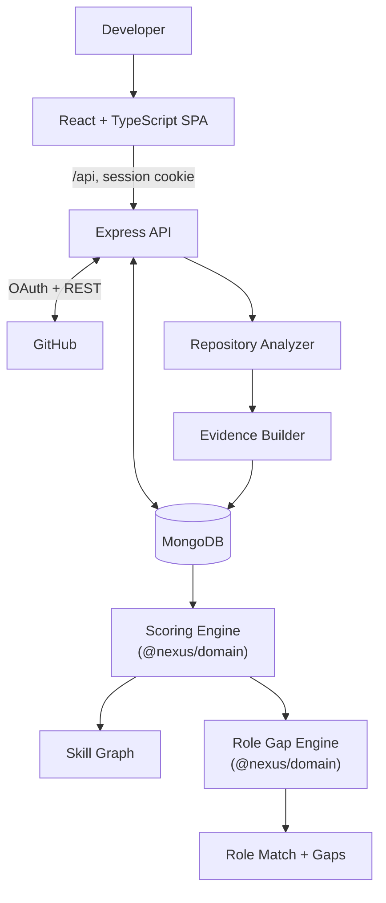

<div align="center">


<br />

**Turn observable GitHub repository signals into explainable skill evidence and role-specific gap analysis.**

<br />

[](https://github.com/Kushall-07/nexus)


</div>

---

## Contents

- [Overview](#overview)
- [The problem](#the-problem)
- [Use cases](#use-cases)
- [Features](#features)
- [How it works](#how-it-works)
- [Architecture](#architecture)
- [Evidence scoring explained](#evidence-scoring-explained)
- [Role gap analysis explained](#role-gap-analysis-explained)
- [Technology stack](#technology-stack)
- [Project structure](#project-structure)
- [Screenshots](#screenshots)
- [Installation and local development](#installation-and-local-development)
- [Limitations and responsible interpretation](#limitations-and-responsible-interpretation)
- [Testing and quality](#testing-and-quality)
- [Roadmap](#roadmap)
- [Contributing](#contributing)
- [License and acknowledgements](#license-and-acknowledgements)

---

## Overview

NEXUS is a full-stack developer tool that reads the **public repositories you choose** on GitHub, collects observable technical signals, and turns them into **per-skill Evidence Scores** you can inspect down to the individual repository.

1. **Connect** your GitHub account (OAuth).
2. **Select** eligible public repositories for analysis.
3. **Collect** observable signals: dependencies, frameworks, source usage, project structure, tests, documentation and activity.
4. **Aggregate** those signals into deterministic, per-skill Evidence Scores.
5. **Explore** the Skill Graph and the evidence behind each score.
6. **Compare** your scores against a curated target role.
7. **Review** a role-specific gap analysis: weighted Role Match, per-skill gaps, and critical gaps.

> **What NEXUS is not.** An Evidence Score summarizes what the analyzer could *observe* in the repositories you selected. It is not a measure of actual ability, a certification, a hiring prediction or a statement about job readiness. Missing evidence does not mean you lack a skill.

### Guiding principles

- **Evidence first.** Every score traces back to stored evidence items from specific repositories.
- **Deterministic scoring.** The same evidence and configuration always produce the same scores. The scoring code is pure: no network, clock, randomness or LLM.
- **Explainability over inflated scores.** Breakdowns are preferred to a single opaque number.
- **Honest benchmarks.** Role requirements are manually curated and versioned, not live job-market data or universal hiring standards.

> **AI status.** The current implementation does **not** call any LLM. `LLM_PROVIDER` / `LLM_API_KEY` appear in `.env.example` as reserved placeholders but are not read by the API. If AI-generated explanations are added in future, they are intended to explain gaps and never to determine numerical scores.

## The problem

A developer's work is spread across many repositories, languages, frameworks and practices. Self-reported skill lists are hard to verify, and a repository list does not summarize itself consistently.

NEXUS offers a structured, repository-backed view: *which observable signals support this skill, in which repositories, and how strongly?* The goal is traceable exploration, not a verdict.

## Use cases

### 1. Developer skill exploration

| | |
|---|---|
| **User action** | Connects GitHub, selects eligible public repositories, runs analysis, opens the Skill Graph (`/`) and a skill page (`/skills/:skillId`). |
| **System behavior** | Analyzes each selected repository, stores normalized evidence, then runs deterministic scoring. |
| **Result** | A score per skill with the evidence items and repositories that produced it. |

### 2. Role-specific gap analysis

| | |
|---|---|
| **User action** | Opens `/roles`, chooses one of five supported roles, and runs gap analysis. |
| **System behavior** | Loads the versioned role benchmark, compares it with the user's latest scoring run, and stores the result. |
| **Result** | Weighted Role Match, per-skill gap and deficit, minimum thresholds, critical gaps, and which skills had no evidence. |

The result is meant to help decide which technical areas or projects to explore next.

### 3. Portfolio evidence exploration

| | |
|---|---|
| **User action** | Opens a skill detail page to see which repositories contributed. |
| **System behavior** | Returns the per-repository contributions and underlying evidence for that skill. |
| **Result** | A view of which projects provide signals for a skill, instead of an unexplained aggregate. |

## Features

Each item below was checked against the current source.

**GitHub connection**
- GitHub OAuth login with the `read:user user:email` scope and a JWT session in an `httpOnly` cookie (7-day expiry).
- GitHub access tokens are stored encrypted (`TOKEN_ENCRYPTION_KEY`).

**Repository discovery and selection**
- Lists the user's **public** repositories, including fork/archived flags.
- Lets the user select repositories for analysis, capped by `MAX_REPOSITORIES_PER_ANALYSIS` (default 15). The cap is enforced atomically on the server.
- Shows GitHub API quota (`/api/github/quota`).

**Repository analysis**
- Detects languages, dependencies (`package.json`, `requirements.txt`, `pyproject.toml`, `go.mod`, `pom.xml`), frameworks, source-level usage, project structure, Docker usage, tests, documentation and activity.
- Bounded by a per-repository request budget (`MAX_REQUESTS_PER_REPOSITORY`, default 10), so only a sample of manifests, configs and source files is read, not every file.

**Deterministic scoring**
- Evidence is normalized into seven signal types and scored with a versioned configuration (`config/scoring.json`).
- Each run is persisted with its `scoringVersion`.

**Skill Graph**
- Skill overview and per-skill detail pages with repository contribution breakdowns and evidence.

**Role gap analysis**
- Five manually curated, versioned role benchmarks (`config/roles.json`), validated strictly at load time.
- Weighted Role Match, per-skill gap and deficit, and critical-gap flags. Missing evidence is shown explicitly.

**Quality**
- Zod-validated environment, request bodies and configuration files.
- Vitest suites across the API, domain package and web app.

## How it works

1. **Connect GitHub** via OAuth.
2. **Retrieve public repositories** through the GitHub REST API (`GET /api/github/repos`).
3. **Select repositories** to analyze (`PATCH /api/github/repos/:id/selection`).
4. **Collect observable signals** per repository (`POST /api/analysis/repositories/:id`), within the request budget.
5. **Normalize and store evidence** as per-repository evidence items (MongoDB `repositoryEvidence`).
6. **Aggregate into skill scores** (`POST /api/analysis/run`). This never calls GitHub; it reads stored evidence and writes an immutable run (MongoDB `analyses`).
7. **Display the Skill Graph and evidence** (`GET /api/skills`, `/api/skills/:id`, `/api/skills/:id/evidence`).
8. **Select a target role** (`GET /api/roles`).
9. **Calculate Role Match and deficits** (`POST /api/gap-analysis`) from the user's latest scoring run.
10. **Present the gap analysis**, stored in `gap_analyses` and retrievable via `GET /api/gap-analysis/:id`.

Persisted entities: `User`, `Repository`, `RepositoryEvidence`, `Analysis` and `GapAnalysis`.

## Architecture



| Layer | Responsibility |
|---|---|
| **Frontend** (`apps/web`) | Repository selection, Skill Graph, skill evidence and role gap views. Talks only to `/api`. |
| **API** (`apps/api`) | OAuth and sessions, GitHub access, repository analysis, evidence persistence, and HTTP endpoints. |
| **Domain** (`packages/domain`) | Pure, dependency-light logic: evidence types, scoring engine, role catalog and Role Match. No I/O. |
| **Config** (`config/`) | Versioned JSON for skills, technologies, scoring and roles. |
| **MongoDB** | Persists users, repositories, evidence, scoring runs and gap analyses. |

## Evidence scoring explained

An **Evidence Score** is a number in **[0, 100]** summarizing how much observable evidence supports a skill across your analyzed repositories. It is **not** a percentage of mastery. The scoring version (currently `1.0.0`, from `config/scoring.json`) is stored with every run.

### Step 1: repository-level score for a skill

Each evidence item feeds one of seven signals. Per signal, the strongest evidence item (normalized strength in [0, 1]) is used, and only signals *applicable* to that skill count.

| Signal | Weight |
|---|---|
| `sourceUsage` | 0.25 |
| `dependency` | 0.20 |
| `framework` | 0.20 |
| `projectStructure` | 0.10 |
| `testing` | 0.10 |
| `activity` | 0.10 |
| `documentation` | 0.05 |

```text
BaseScore  = 100 × Σ(weight × strength) / Σ(weight)        over applicable signals
Meaningful = applicable signals with strength ≥ 0.25
Breadth    = 0.5 (1 meaningful) · 0.75 (2) · 1.0 (3 or more)   (0.5 if none)
RepoScore  = BaseScore × Breadth
```

Which signals apply depends on the skill (for example, `python` uses only `sourceUsage` and `activity`; `react` uses six signals). See `applicability` in `config/scoring.json`.

### Step 2: combining repositories

Repositories with a score of 0 are dropped. The rest are ranked by score and the **top 5** are kept.

```text
Substance  = 0.25 + 0.75 × (0.7 × sourceDepth + 0.3 × structureDepth)     (range 0.25–1)
Weight_i   = Substance_i × 0.6^(rank_i − 1)
FinalScore = Σ(RepoScore_i × Weight_i) / Σ(Weight_i)
```

`sourceDepth` grows logarithmically with the repository's source-file count (capped at a 50-file reference); `structureDepth` is the count of relevant structure signals relative to a reference of 5. Substance describes the observable project surface, not its quality.

<details>
<summary><strong>Worked example (illustrative values, not real data)</strong></summary>

A skill with two applicable signals, `sourceUsage` (weight 0.25) at strength 0.8 and `activity` (weight 0.10) at strength 0.5:

- `BaseScore = 100 × (0.25×0.8 + 0.10×0.5) / 0.35 = 71.4`
- Both signals are ≥ 0.25, so Breadth = 0.75 and `RepoScore = 53.6`

Two repositories contribute to the same skill:

| Repo | RepoScore | Substance | Rank | Weight |
|---|---|---|---|---|
| A | 80 | 0.9 | 1 | 0.9 × 1.0 = 0.90 |
| B | 60 | 0.7 | 2 | 0.7 × 0.6 = 0.42 |

`FinalScore = (80×0.90 + 60×0.42) / (0.90 + 0.42) = 73.6`

</details>

### Missing evidence

A skill with no evidence has no score in the scoring run. For role matching it is counted as **0**, which is a calculation convention, not a claim that the skill is absent. The UI flags such skills as having no available evidence.

## Role gap analysis explained

| Term | Meaning |
|---|---|
| **Evidence Score** | The skill's final score, 0–100 (0 if no evidence). |
| **Minimum required score** | The role's per-skill threshold from the catalog. |
| **Gap** | `score − minimum` (signed). |
| **Deficit** | `max(minimum − score, 0)`. |
| **Critical gap** | `score < minimum` (strict; equal to the minimum is not critical). Derived per skill, independent of the overall match. |
| **Role Match** | `Σ(score × weight)` over the role's requirements, clamped to [0, 100]. Weights sum to 1 and are never renormalized over skills that have evidence. |

<details>
<summary><strong>Worked example (illustrative values, not a real role)</strong></summary>

| Skill | Score | Weight | Minimum | Contribution | Critical gap |
|---|---|---|---|---|---|
| A | 80 | 0.5 | 50 | 40.0 | No |
| B | 40 | 0.3 | 45 | 12.0 | Yes (deficit 5) |
| C | no evidence → 0 | 0.2 | 40 | 0.0 | Yes (deficit 40) |

`Role Match = 40 + 12 + 0 = 52`

</details>

### Supported roles

Software Engineer · Full-Stack Developer · Backend Engineer · AI Engineer · ML Engineer

Requirements (skills, weights and minimums) live in [config/roles.json](config/roles.json) under `roleCatalogVersion` `1.0.0`. They are **manually curated and versioned**. They are not live job-market data or universal hiring criteria.

## Technology stack

| Layer | Technology | Responsibility |
|---|---|---|
| Frontend | React 19, React Router 7 | UI and routing (`/`, `/skills/:skillId`, `/repositories`, `/roles`). |
| Frontend | TypeScript, Vite 8 | Typed code, dev server (proxies `/api` to port 4000) and build. |
| Frontend | Tailwind CSS 4 | Styling. |
| Backend | Node.js ≥ 20, Express 5 | HTTP API. |
| Backend | `jsonwebtoken`, `cookie-parser` | Session tokens in cookies. |
| Backend | `fast-xml-parser`, `smol-toml` | Parsing `pom.xml` and `pyproject.toml` manifests. |
| Data | MongoDB 8 (Docker image), Mongoose 9 | Persistence and models. |
| Integration | GitHub OAuth and REST API | Login and public repository data. |
| Shared | Zod 4 | Validation of env, requests and configuration. |
| Quality | Vitest, Supertest, Testing Library, jsdom | Unit, API and UI tests. |

## Project structure

```text
nexus/
├── apps/
│   ├── api/                 Express API
│   │   ├── src/analyzer/    Repository analysis (dependencies, frameworks, tests, docs, ...)
│   │   ├── src/evidence/    Analysis -> normalized evidence items
│   │   ├── src/services/    GitHub, sessions, scoring, gap analysis
│   │   ├── src/controllers/ src/routes/ src/models/ src/middleware/
│   │   └── tests/
│   └── web/                 React SPA (src/features: skills, repositories, roles)
├── packages/domain/         Pure scoring engine, role engine, evidence and skill types
├── config/                  skills.json, technologies.json, scoring.json, roles.json
├── docs/                    architecture, scoring and per-phase implementation notes
├── docker-compose.yml       Local MongoDB
└── .env.example             Environment template (placeholders only)
```

## Screenshots

No screenshots are committed yet, and there is no verified public demo. Planned captures:

- [ ] Repositories page
- [ ] Skill Graph
- [ ] Skill evidence page
- [ ] Target Role gap analysis

<!-- Add real screenshots under docs/assets/ and reference them here. -->

## Installation and local development

### Prerequisites

- Node.js ≥ 20 and npm ≥ 10
- MongoDB (a Docker Compose file is provided) and Docker, if you use it
- A [GitHub OAuth App](https://github.com/settings/developers) with callback URL `http://localhost:4000/api/auth/github/callback`

### Setup

```bash
git clone https://github.com/Kushall-07/nexus.git
cd nexus
npm install

# start MongoDB (listens on localhost:27017)
docker compose up -d

# create your local env file, then fill in the values
cp .env.example .env
```

In `.env`, set the following (never commit this file):

| Variable | Notes |
|---|---|
| `MONGODB_URI` | Default `mongodb://localhost:27017/nexus` matches the Compose file. |
| `JWT_SECRET` | Required, at least 32 characters. |
| `GITHUB_CLIENT_ID`, `GITHUB_CLIENT_SECRET` | From your GitHub OAuth App. |
| `TOKEN_ENCRYPTION_KEY` | Required. Used to encrypt stored GitHub tokens. |
| `FRONTEND_URL`, `BACKEND_URL` | Defaults `http://localhost:5173` and `http://localhost:4000`. |
| `MAX_REPOSITORIES_PER_ANALYSIS`, `MAX_REQUESTS_PER_REPOSITORY` | Optional, defaults 15 and 10. |

`ANALYSIS_COOLDOWN_MINUTES`, `LLM_PROVIDER` and `LLM_API_KEY` are listed in `.env.example` but are not read by the current code.

### Run

```bash
npm run dev:api   # API on http://localhost:4000
npm run dev       # frontend on http://localhost:5173 (in a second terminal)
```

Open <http://localhost:5173> and sign in with GitHub.

### Scripts

```bash
npm test            # all workspaces
npm run typecheck   # all workspaces
npm run build       # all workspaces
```

### Troubleshooting

- **API exits on startup with a validation error.** A required variable in `.env` is missing or invalid (for example `JWT_SECRET` shorter than 32 characters). The `.env` file is read from the repository root.
- **MongoDB connection refused.** Check that `docker compose up -d` is running and `MONGODB_URI` points to it.
- **OAuth redirect mismatch.** The OAuth App callback URL must equal `BACKEND_URL` + `/api/auth/github/callback`.
- **Login works but the session is lost.** Keep `FRONTEND_URL` and `BACKEND_URL` consistent with the URLs you actually open.

## Limitations and responsible interpretation

- Only supported signals from **public** repositories you select are considered.
- Analysis samples a limited number of manifests, configs and source files per repository; it does not read every file, commit or dependency.
- Not every skill or engineering practice is detectable. A missing signal may reflect analyzer limits, and meaningful work may go unrecognized.
- Commit activity is a signal, not proof of expertise. Language shares do not measure proficiency.
- Evidence Scores are not hiring assessments, certifications or measures of ability.
- Role benchmarks are manually curated and versioned, not live market data.
- No AI component currently influences or explains scores.

## Testing and quality

Test framework: [Vitest](https://vitest.dev) (API with Supertest, web with Testing Library and jsdom).

```bash
npm test
npm run typecheck
npm run build
```

No CI workflow or coverage report is configured in the repository, so none is claimed here.

## Roadmap

**Implemented:** GitHub OAuth, repository selection, repository analyzer, evidence engine, deterministic scoring, Skill Graph, five-role gap analysis.

**Possible future investigation (not commitments):** richer evidence detection, improved test and documentation signals, better explainability, additional evidence types, and optional AI-written gap explanations that would never set scores.

## Contributing

Issues and pull requests are welcome at [github.com/Kushall-07/nexus](https://github.com/Kushall-07/nexus/issues).

1. Branch from `main` and keep changes focused.
2. Run `npm test` and `npm run typecheck` before opening a pull request.
3. Do not change scoring formulas, role weights or thresholds without updating the configuration versions and the related tests and docs.
4. Never commit `.env` or any credentials.

Design notes for each phase are in [docs/implementation](docs/implementation/README.md).

## License and acknowledgements

No license file is present in the repository, so no open-source license is declared. Contact the repository owner before reusing the code.

NEXUS builds on [React](https://react.dev), [Vite](https://vite.dev), [Tailwind CSS](https://tailwindcss.com), [Express](https://expressjs.com), [MongoDB](https://www.mongodb.com), [Mongoose](https://mongoosejs.com), [Zod](https://zod.dev), [Vitest](https://vitest.dev) and the [GitHub REST API](https://docs.github.com/rest).

---

<div align="center">

**NEXUS** reads what your public repositories show, scores it deterministically, and lets you inspect every number back to its evidence.

[Repository](https://github.com/Kushall-07/nexus) · [Issues](https://github.com/Kushall-07/nexus/issues) · [Docs](docs/implementation/README.md) · [Scoring config](config/scoring.json) · [Role catalog](config/roles.json)

</div>
