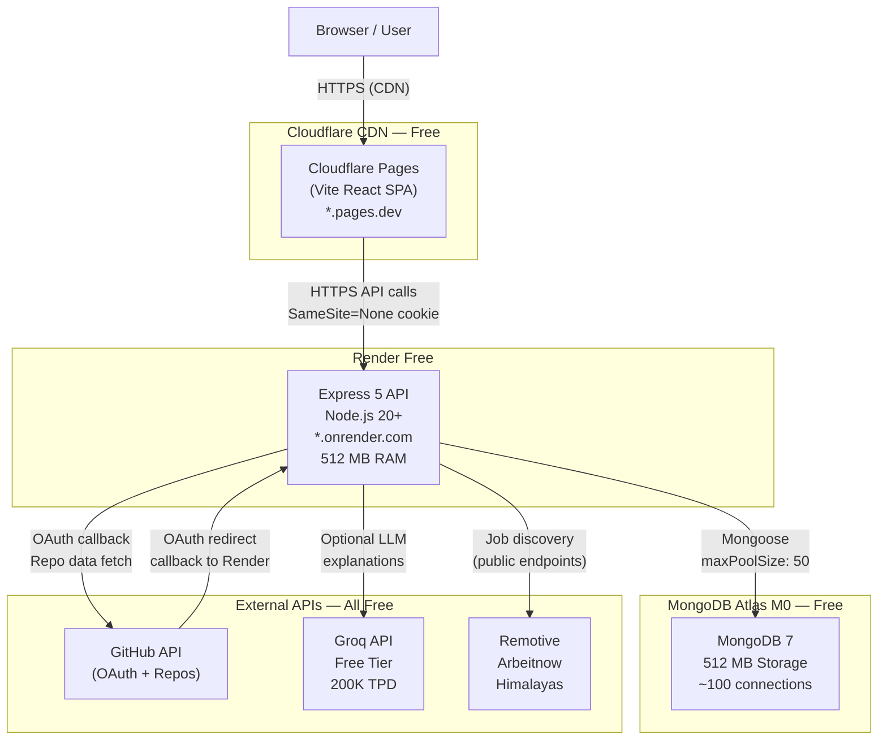

# PHASE 8 — ZERO-COST DEPLOYMENT PLAN

**Date:** 2026-11-09  
**Status:** PLANNING — Awaiting Approval  
**Constraint:** ₹0 absolute budget — no paid services, subscriptions, credits, or add-ons

---

## 1. Executive Summary

NEXUS is a TypeScript monorepo consisting of:
- A Vite + React 19 SPA (static output in `apps/web/dist`)
- An Express 5 + Node.js API (`apps/api`)
- A shared domain package (`packages/domain`)

The application has no background workers, no WebSockets, no persistent file storage, and no paid service dependencies in its core path. All features except the Career Copilot AI explanations operate fully without an LLM. Resume processing is performed in-memory with no cloud storage. Three job discovery APIs (Remotive, Arbeitnow, Himalayas) are publicly free with no API key requirement.

**Recommended architecture:**

| Tier | Service | Plan |
|---|---|---|
| Frontend | **Cloudflare Pages** | Free |
| Backend | **Render** | Free |
| Database | **MongoDB Atlas** | M0 Free |
| LLM (optional) | **Groq** | Free |
| Job Discovery | Remotive + Arbeitnow + Himalayas | Free (no key) |
| Domain | `*.pages.dev` + `*.onrender.com` | Free subdomains |
| HTTPS | Automatic (both platforms) | Free |

**Total monthly cost: ₹0**

**Feasibility verdict (preliminary):** FEASIBLE WITH FEATURE LIMITATIONS — all core features work at zero cost; Career Copilot AI explanations are rate-limited by Groq's 200 K tokens/day free cap; Render cold starts (~60 seconds after 15 min idle) affect perceived performance.

---

## 2. Recommended Architecture



**Data flows:**

1. User loads SPA from Cloudflare Pages CDN (globally cached static assets).
2. SPA makes HTTPS requests to the Render API; `SameSite=None; Secure` cookies enable cross-origin authentication.
3. API connects to MongoDB Atlas M0 via Mongoose connection pool.
4. GitHub OAuth: browser redirected to GitHub → GitHub calls back to `BACKEND_URL/api/auth/github/callback` on Render → API issues JWT session cookie → browser returns to SPA.
5. LLM: Optional. API calls Groq directly (HTTP POST to `api.groq.com`) only for Career Copilot natural-language explanations.
6. Job discovery: API calls three public, keyless APIs and merges results with in-memory TTL cache.

---

## 3. Official Free-Tier Verification

### 3.1 Cloudflare Pages (Frontend)

| Attribute | Value |
|---|---|
| Cost | $0 — no payment required |
| Builds | 500/month, 1 concurrent |
| Bandwidth | **Unlimited** (served from Cloudflare CDN) |
| File count | 20,000 per site |
| File size limit | 25 MiB per file |
| Custom domains | Unlimited (free) |
| Cold starts | None — static assets served from CDN |
| Commercial use | Allowed |
| Auto-upgrade risk | None |

**Source:** `https://developers.cloudflare.com/pages/platform/limits/`

**Assessment:** Best free option for a Vite SPA. Unlimited bandwidth eliminates the 100 GB cap found on Vercel Hobby. No commercial restrictions.

### 3.2 Render Free (Backend)

| Attribute | Value |
|---|---|
| Cost | $0 — no payment required initially |
| RAM | 512 MB |
| CPU | 0.1 shared vCPU |
| Instance hours | 750/month (~24/7 for one service) |
| Spin-down | After **15 minutes of inactivity** |
| Cold start | ~60 seconds on first request after spin-down |
| Persistent disk | None (ephemeral filesystem) |
| SSH / shell | Not available on free plan |
| Scaling | 1 instance only |
| Bandwidth overage | Service suspended (no charge) |
| Auto-upgrade | Does not auto-upgrade; requires manual action |

**Source:** `https://render.com/docs/free`

**Assessment:** Suitable for a low-traffic API. The 15-minute spin-down and ~60 second cold start are the primary user-experience concerns. The app requires no persistent local disk (resume processing is in-memory; no log files are required).

### 3.3 MongoDB Atlas M0 (Database)

| Attribute | Value |
|---|---|
| Cost | $0 — no payment required |
| Storage | 512 MB (shared infrastructure) |
| RAM | Shared |
| Max connections | ~100 (shared cluster cap) |
| Replica set | 3-node (data is replicated) |
| Network transfer | Throttled; exact GB not published |
| Point-in-time restore | Not available |
| Atlas Search | Not available |
| Encryption at rest | Not available |
| SLA | None (community support) |
| Auto-upgrade | Does not auto-upgrade |

**Source:** `https://www.mongodb.com/pricing`

**Assessment:** 512 MB is sufficient for NEXUS at private beta scale (thousands of users, not millions). The ~100 connection cap requires care — see compatibility section.

### 3.4 Groq API (LLM — Optional)

| Attribute | Value |
|---|---|
| Cost | $0 — no payment required |
| Rate limit (RPM) | 30 requests/minute |
| Tokens per day (TPD) | ~200,000 (per model) |
| Supported models | openai/gpt-oss-120b and others |
| Billing risk | None — free tier enforced by rate limiting, no charge |
| Auto-upgrade | Does not auto-upgrade |

**Source:** `https://console.groq.com/docs/rate-limits`

**Assessment:** Groq is the preferred LLM provider. At 200K TPD, the free tier supports approximately 100–200 Career Copilot explanation requests per day at ~1,000–2,000 tokens each. This is sufficient for private beta.

### 3.5 Google Gemini API (LLM — Fallback)

| Attribute | Value |
|---|---|
| Cost | $0 — no payment required (AI Studio key) |
| Free models | Gemini 2.5 Flash, 3.1–3.8 Flash-Lite, Gemini Embedding |
| Paid-only models | Gemini Pro, Gemini 4 Argon (flagship) |
| Rate limits | Varies; visible in AI Studio dashboard |
| Data usage | Prompts may be used to improve Google's products |
| Auto-upgrade | Does not auto-upgrade if using AI Studio key |

**Source:** `https://aistudio.google.com/docs/pricing`

**Assessment:** Viable fallback if Groq is unavailable. The model configured in NEXUS (`gemini-2.5-flash`) is free on AI Studio. The data usage policy (prompts used to train Google's models) should be disclosed to beta users.

### 3.6 Free Job Discovery APIs (Keyless)

| Provider | Key Required | Cost | Assessment |
|---|---|---|---|
| Remotive | No | $0 | Fully free public API; remote jobs only |
| Arbeitnow | No | $0 | Fully free public API; mixed job types |
| Himalayas | No | $0 | Fully free public API; tech-focused jobs |
| Demo provider | N/A | $0 | Built-in fixture data; always available as fallback |

All three free providers are configured in NEXUS and activated via environment variables (`REMOTIVE_ENABLED=true`, etc.) with no API key requirement.

### 3.7 Services Evaluated and Rejected

| Service | Reason Rejected |
|---|---|
| Vercel Hobby (frontend) | **Commercial use explicitly prohibited** on the Hobby plan. Acceptable only for strictly personal, non-commercial use. Cloudflare Pages is superior in every dimension and has no such restriction. |
| Vercel (backend/API) | Same commercial use restriction applies. Additionally, `express.static()` does not function on Vercel, and the 250 MB bundle limit may be tight for the full monorepo. |
| Cloudflare Workers (backend) | **10 ms CPU time per invocation** on the free plan. Express middleware chains, Zod validation, and Mongoose query processing routinely exceed this limit. Incompatible. |
| Railway Free | $1/month compute credit ≈ ~36 hours of runtime. Service stops for the remaining ~28 days each month. Not viable for a persistent API. |
| Fly.io | No permanent free tier. 7-day trial credit only. Payment method required thereafter. Minimum ~$2.19/month. |
| Koyeb Free | Genuinely free (512 MB, 1 vCPU, 2 regions). Viable alternative to Render. No persistent volumes. Region selection is restricted to Frankfurt/Washington D.C. only. Less battle-tested than Render. **Retained as backup option.** |

---

## 4. Hosting Alternatives

### 4.1 Frontend Alternatives

| Service | Verdict | Notes |
|---|---|---|
| **Cloudflare Pages** | **RECOMMENDED** | Unlimited bandwidth, global CDN, no commercial restrictions, 500 builds/month |
| Vercel Hobby | Viable (non-commercial only) | 100 GB bandwidth cap; commercial use prohibited |
| GitHub Pages | Viable | Unlimited bandwidth; requires static output pushed to `gh-pages` branch; no server-side logic |
| Netlify Free | Viable | 100 GB bandwidth/month; 300 build minutes/month |

### 4.2 Backend Alternatives

| Service | Verdict | Notes |
|---|---|---|
| **Render Free** | **RECOMMENDED** | 512 MB RAM; 15-min spin-down; no payment required; most established free Node.js host |
| Koyeb Free | Viable backup | 512 MB RAM; Frankfurt/Washington only; no spin-down config |
| Cloudflare Workers | Not viable | 10 ms CPU cap incompatible with Express middleware |
| Railway Free | Not viable | $1/month ≈ 36 hours runtime; services stop |
| Fly.io | Not viable | No free tier; payment required after 7 days |

---

## 5. NEXUS Compatibility Analysis

### 5.1 Frontend — Cloudflare Pages Compatibility

| Check | Result |
|---|---|
| Output type | Static SPA (`apps/web/dist/index.html` + hashed assets) — compatible |
| Framework | Vite + React 19 — Cloudflare Pages has first-class Vite support |
| Build command | `npm ci && npm run build --workspace=packages/domain && npm run build --workspace=apps/web` |
| Output directory | `apps/web/dist` |
| Node version | 22 (must be set in Cloudflare Pages settings to match CI) |
| `VITE_API_BASE_URL` | **Must be set as a build-time environment variable** in Cloudflare Pages. Without it, the SPA generates relative `/api` URLs which only work with the Vite dev proxy — these will fail in production. Set to the Render service URL (e.g., `https://nexus-api.onrender.com`). |
| Three.js hero | Runs entirely in-browser via WebGL — no server dependency |
| Tailwind CSS | Compiled at build time — no server dependency |
| SPA routing | All routes served from `index.html` — Cloudflare Pages handles this automatically for SPAs |

### 5.2 Backend — Render Free Compatibility

| Check | Result |
|---|---|
| Runtime | Node.js 20+ — Render supports this natively |
| Start command | `node apps/api/dist/server.js` |
| Build command | `npm ci && npm run build --workspace=packages/domain && npm run build --workspace=apps/api` |
| Persistent process | Express runs as a persistent HTTP server — compatible |
| Background workers | None — not required |
| Background jobs | None — not present |
| WebSockets | Not used — not required |
| Long-running tasks | Repository analysis runs synchronously within a single request — compatible, but may approach request timeout on very large repositories |
| Ephemeral filesystem | App does not write to disk in production (resume text stored in MongoDB, no local logs required) — compatible |
| `PORT` | Render injects `PORT` automatically as an environment variable — compatible with `env.PORT` usage in `server.ts` |
| `TRUST_PROXY` | **Must be set to `1`** — Render routes traffic through a proxy layer; without this, `req.ip` returns the proxy IP, not the real user IP, breaking per-IP rate limiting |

### 5.3 Database — MongoDB Atlas M0 Compatibility

| Check | Result |
|---|---|
| Connection string | Atlas provides a `mongodb+srv://` URI — set as `MONGODB_URI` |
| `maxPoolSize: 50` | With a single Render free instance, the pool will use at most 50 connections against Atlas M0's ~100 connection cap. Acceptable for private beta, but approaching the limit if connection overhead spikes. Consider reducing to 10 in a future release for safety headroom. **No code change is made in this plan.** |
| Mongoose version | 9.10.4 — fully compatible with Atlas M0 |
| Indexes | All 8 collections use standard B-tree indexes — fully supported on M0 |
| Atlas Search | Not used in NEXUS (all queries use standard MongoDB queries) — no compatibility issue |
| File storage | Not used (no GridFS, no file attachments) — no compatibility issue |
| TTL index | `revoked_sessions` uses a TTL index for auto-expiry — fully supported on M0 |
| Transactions | Not used — no compatibility issue |

### 5.4 Resume Processing

Resume files are parsed in-memory using `pdf-parse` and `mammoth`. Only the extracted text is persisted to MongoDB. No file is written to disk. No cloud object storage (S3, GCS, Cloudflare R2) is required. This is fully compatible with Render's ephemeral filesystem.

### 5.5 LLM Integration

The LLM integration is entirely optional. If `LLM_PROVIDER` or `LLM_API_KEY` is absent from the environment, the Career Copilot operates in a degraded mode (deterministic responses only). Setting `LLM_PROVIDER=groq` and providing a Groq API key enables full AI explanations using the Groq free tier.

The app is already configured for Groq with the model `openai/gpt-oss-120b` and for Gemini with `gemini-2.5-flash` — both are within the free tier.

### 5.6 GitHub OAuth with Platform Subdomains

The OAuth callback URL is constructed from the `BACKEND_URL` environment variable:

```
${env.BACKEND_URL}/api/auth/github/callback
```

For Render, this becomes:
```
https://nexus-api.onrender.com/api/auth/github/callback
```

This URL must be registered in the GitHub OAuth application settings. Platform subdomains are fully supported by GitHub OAuth — there is no requirement for a custom domain.

### 5.7 CORS and Cookie Configuration

The app configures CORS as:
```typescript
cors({ origin: env.FRONTEND_URL, credentials: true })
```

In production, `FRONTEND_URL` must be the exact Cloudflare Pages origin (e.g., `https://nexus.pages.dev`). No wildcard is used.

Session cookies are set with `SameSite=None; Secure` in production, which is required for cross-origin cookie sharing between the Cloudflare Pages frontend and the Render backend. Both platforms terminate HTTPS, so the `Secure` flag is satisfied automatically.

### 5.8 Persistent Storage

| Storage need | Assessment |
|---|---|
| Resume files | In-memory processing only — not persisted as files |
| Uploaded documents | Not supported — only text extraction result is stored |
| Application logs | Not written to disk — `console.log` only (Render captures stdout) |
| Session state | Stored in MongoDB (`revoked_sessions` collection) |
| All user data | Stored in MongoDB — persistent across Render redeploys |

There is no requirement for a persistent disk, object storage, or CDN file hosting.

---

## 6. Feature Availability Matrix

| NEXUS Feature | Free Deployment Support | Limitations | Recommendation |
|---|---|---|---|
| **User authentication** | Full | None — GitHub OAuth callback works with Render subdomain | Enable; configure production GitHub OAuth app |
| **GitHub integration** | Full | GitHub API rate limits apply (5,000 req/hr for authenticated users) | Enable; encrypted token stored in Atlas |
| **Repository analysis** | Full | Analysis runs synchronously; very large repositories (100+ files) may approach Render's request timeout | Enable; set `MAX_REPOSITORIES_PER_ANALYSIS=10` for safety |
| **Deterministic scoring** | Full | None — no external dependencies, runs in-process | Enable |
| **Skill graph** | Full | None — computed from scoring result, rendered in-browser | Enable |
| **Role-gap analysis** | Full (deterministic) | Deterministic portion is always available; LLM explanations limited to ~100–200/day on Groq free tier | Enable; configure Groq LLM |
| **Career Copilot** | Partial — requires LLM | 200K tokens/day on Groq free; heavy usage may exhaust daily quota; app works without LLM but explanations are disabled | Enable with Groq; communicate daily cap to beta users |
| **Job discovery** | Full | Remotive/Arbeitnow/Himalayas are public APIs with their own rate limits; demo fallback always available | Enable all three free providers |
| **Resume processing** | Full | 5 MB max upload; PDF and DOCX only; image-only PDFs rejected | Enable; no configuration change needed |
| **Application tracking** | Full | None — stored in MongoDB `saved_jobs` collection | Enable |

---

## 7. Environment Variable Requirements

### 7.1 Backend (Render) — Required

| Variable | Value | Notes |
|---|---|---|
| `NODE_ENV` | `production` | Enables HTTPS cookies, HSTS header, production error handling |
| `PORT` | _(injected by Render automatically)_ | Do not set manually |
| `MONGODB_URI` | `mongodb+srv://...` | From Atlas M0 connection string; include username/password |
| `JWT_SECRET` | _(generate)_ | Minimum 32 characters; use `openssl rand -base64 48` |
| `GITHUB_CLIENT_ID` | _(from GitHub OAuth app)_ | Production OAuth app only |
| `GITHUB_CLIENT_SECRET` | _(from GitHub OAuth app)_ | Production OAuth app only |
| `TOKEN_ENCRYPTION_KEY` | _(generate)_ | Must base64-decode to exactly 32 bytes; use `openssl rand -base64 32` |
| `FRONTEND_URL` | `https://[your-subdomain].pages.dev` | Exact Cloudflare Pages URL; no trailing slash |
| `BACKEND_URL` | `https://[your-service].onrender.com` | Exact Render URL; no trailing slash |
| `TRUST_PROXY` | `1` | Required on Render (sits behind a proxy layer) |

### 7.2 Backend (Render) — Recommended

| Variable | Value | Notes |
|---|---|---|
| `LLM_PROVIDER` | `groq` | Enables Career Copilot AI explanations |
| `LLM_API_KEY` | _(from Groq console)_ | Groq API key; free tier, no card needed |
| `REMOTIVE_ENABLED` | `true` | Enables Remotive free job provider |
| `ARBEITNOW_ENABLED` | `true` | Enables Arbeitnow free job provider |
| `HIMALAYAS_ENABLED` | `true` | Enables Himalayas free job provider |
| `ANALYSIS_COOLDOWN_MINUTES` | `60` | Prevents repeated heavy analysis requests |
| `MAX_REPOSITORIES_PER_ANALYSIS` | `10` | Conservative limit for free tier (default is 15) |
| `MAX_REQUESTS_PER_REPOSITORY` | `10` | Default; leave unchanged |
| `JOB_CACHE_TTL_SECONDS` | `3600` | Default; keeps job API calls minimal |
| `RESUME_MAX_BYTES` | `5242880` | 5 MB; default; leave unchanged |

### 7.3 Frontend Build (Cloudflare Pages) — Required

| Variable | Value | Notes |
|---|---|---|
| `VITE_API_BASE_URL` | `https://[your-service].onrender.com` | Baked into the SPA bundle at build time; must match `BACKEND_URL` exactly |

> **Important:** `VITE_API_BASE_URL` is a **build-time** variable, not a runtime variable. It must be set in Cloudflare Pages build settings before the first deployment. Any change to this value requires a new build.

### 7.4 Variables Not Required in Production

| Variable | Reason |
|---|---|
| `JSEARCH_API_KEY` | Paid RapidAPI service; do not use |
| `ADZUNA_APP_ID` / `ADZUNA_APP_KEY` | Requires registration; not needed with free providers enabled |
| `LLM_BASE_URL` | Only for `openai-compatible` provider; not used with Groq or Gemini |
| `LLM_MODEL` | Pre-configured defaults exist for Groq and Gemini |
| `E2E_RATE_LIMIT_MAX` | Test-only; explicitly rejected in production by the app |

---

## 8. GitHub OAuth Requirements

### 8.1 Production OAuth Application

A **separate** GitHub OAuth application must be registered for production. Do not reuse the development OAuth app — callback URLs must match exactly.

**GitHub OAuth App settings:**

| Field | Value |
|---|---|
| Application name | `NEXUS` (or any descriptive name) |
| Homepage URL | `https://[your-subdomain].pages.dev` |
| Authorization callback URL | `https://[your-service].onrender.com/api/auth/github/callback` |

**Registration URL:** `https://github.com/settings/applications/new`

### 8.2 OAuth Flow

```
1. User clicks "Sign in with GitHub" on SPA
2. SPA redirects to: https://github.com/login/oauth/authorize?client_id=...&state=...&scope=read:user+user:email
3. GitHub redirects to: https://[render-service].onrender.com/api/auth/github/callback?code=...&state=...
4. API exchanges code for token, encrypts token, creates session, sets httpOnly cookie
5. API redirects browser to: https://[pages-subdomain].pages.dev (or /dashboard)
6. SPA reads session cookie on subsequent API requests
```

### 8.3 Cookie Cross-Origin Requirements

Since the frontend (`*.pages.dev`) and backend (`*.onrender.com`) are on different domains, the session cookie requires:
- `SameSite=None` — allows cross-site context
- `Secure` — required when `SameSite=None` (HTTPS only)
- `HttpOnly` — protects against XSS

Both `SameSite=None` and `Secure` are automatically applied when `NODE_ENV=production` in the existing auth config. No code changes required.

---

## 9. Deployment Sequence

### Prerequisites

- Git repository pushed to GitHub (already done — HEAD: `f9c55ad`)
- GitHub account with repository access
- Cloudflare account (free, no payment)
- Render account (free, no payment)
- MongoDB Atlas account (free, no payment)
- Groq account (optional, free, no payment)
- Node.js 22 available locally for secret generation

---

### Step 1 — Create MongoDB Atlas M0 Cluster

**Prerequisites:** None  
**Expected outcome:** A `mongodb+srv://` connection string with read/write access

1. Register at `https://www.mongodb.com/atlas/database` (no payment required).
2. Create a new project named `nexus`.
3. Create a **free M0 cluster** (AWS, any available free-tier region, e.g., `us-east-1`).
4. When prompted for database access, create a database user (username: `nexus`, generate a strong password). Store the password securely.
5. When prompted for network access, add `0.0.0.0/0` (allow from anywhere) — required because Render's IP is dynamic on the free plan.
6. Copy the connection string from the Atlas UI: `Connect → Drivers → Node.js`. It looks like: `mongodb+srv://nexus:<password>@cluster0.xxxxx.mongodb.net/?retryWrites=true&w=majority`
7. Replace `<password>` with the generated password. Append `&appName=nexus` optionally.

**Result:** `MONGODB_URI` value.

---

### Step 2 — Register GitHub Production OAuth Application

**Prerequisites:** GitHub account  
**Expected outcome:** `GITHUB_CLIENT_ID` and `GITHUB_CLIENT_SECRET`

1. Navigate to `https://github.com/settings/applications/new`.
2. Fill in:
   - **Application name:** NEXUS
   - **Homepage URL:** `https://nexus.pages.dev` _(placeholder — update after Step 5)_
   - **Authorization callback URL:** `https://nexus-api.onrender.com/api/auth/github/callback` _(placeholder — update after Step 4)_
3. Click **Register application**.
4. Copy the **Client ID**. This is `GITHUB_CLIENT_ID`.
5. Click **Generate a new client secret**. Copy immediately — it is shown only once. This is `GITHUB_CLIENT_SECRET`.

> **Note:** The Homepage URL and callback URL are placeholders at this point. They must be updated with the real subdomain URLs after Steps 4 and 5. GitHub OAuth will not function until the callback URL matches exactly.

---

### Step 3 — Generate Production Secrets

**Prerequisites:** `openssl` available in terminal  
**Expected outcome:** `JWT_SECRET` and `TOKEN_ENCRYPTION_KEY` values

```bash
# Generate JWT_SECRET (48 bytes → 64 base64 chars, comfortably above 32-char minimum)
openssl rand -base64 48

# Generate TOKEN_ENCRYPTION_KEY (exactly 32 bytes → 44 base64 chars; decodes to 32 bytes)
openssl rand -base64 32
```

Store both values in a local password manager immediately. Do not commit them to Git.

---

### Step 4 — Create Render Web Service (Backend)

**Prerequisites:** Render account, GitHub repo accessible  
**Expected outcome:** Render service URL (`https://[name].onrender.com`)

1. Register at `https://render.com` (no payment required).
2. Click **New → Web Service**.
3. Connect the NEXUS GitHub repository.
4. Configure:

| Field | Value |
|---|---|
| Name | `nexus-api` (or preferred name) |
| Region | Oregon or Ohio (closest to Atlas free-tier region) |
| Branch | `main` |
| Root Directory | _(leave blank — build runs from repo root)_ |
| Runtime | Node |
| Build Command | `npm ci && npm run build --workspace=packages/domain && npm run build --workspace=apps/api` |
| Start Command | `node apps/api/dist/server.js` |
| Instance Type | **Free** |

5. Under **Environment Variables**, add all variables from Section 7.1 and 7.2. Use the values generated in Steps 1–3. Set `FRONTEND_URL` to the placeholder `https://nexus.pages.dev` for now (update after Step 5).
6. Click **Create Web Service**.
7. Wait for the first deploy to complete. Record the assigned URL (e.g., `https://nexus-api.onrender.com`).

---

### Step 5 — Create Cloudflare Pages Site (Frontend)

**Prerequisites:** Cloudflare account, Render service URL from Step 4  
**Expected outcome:** Cloudflare Pages URL (`https://[name].pages.dev`)

1. Register at `https://dash.cloudflare.com` (no payment required).
2. Navigate to **Workers & Pages → Create → Pages → Connect to Git**.
3. Connect the NEXUS GitHub repository.
4. Configure:

| Field | Value |
|---|---|
| Project name | `nexus` (or preferred name — this sets the subdomain) |
| Production branch | `main` |
| Framework preset | None (manual) |
| Build command | `npm ci && npm run build --workspace=packages/domain && npm run build --workspace=apps/web` |
| Build output directory | `apps/web/dist` |

5. Under **Environment Variables → Production**, add:
   - `VITE_API_BASE_URL` = `https://nexus-api.onrender.com` (the Render URL from Step 4)
   - `NODE_VERSION` = `22`
6. Click **Save and Deploy**.
7. Wait for build to complete. Record the assigned URL (e.g., `https://nexus.pages.dev`).

---

### Step 6 — Update GitHub OAuth and Render with Final URLs

**Prerequisites:** Both URLs known (Steps 4 and 5)  
**Expected outcome:** OAuth callbacks and CORS work with real URLs

1. In GitHub OAuth app settings (`https://github.com/settings/developers`):
   - Update **Homepage URL** to `https://nexus.pages.dev`
   - Update **Authorization callback URL** to `https://nexus-api.onrender.com/api/auth/github/callback`
   - Click **Update application**.

2. In Render environment variables:
   - Update `FRONTEND_URL` to `https://nexus.pages.dev`
   - Update `BACKEND_URL` to `https://nexus-api.onrender.com`
   - Render will trigger an automatic redeploy.

---

### Step 7 — Verify Backend Health

**Prerequisites:** Render deploy completed, Atlas cluster running  
**Expected outcome:** API responds, database connected

1. Open a browser or use `curl`:
   ```
   GET https://nexus-api.onrender.com/api/auth/session
   ```
   Expected: `401 Unauthorized` JSON response (not an error page; confirms Express is running).

2. Check Render logs for:
   ```
   NEXUS API running on port [PORT]
   ```
   This confirms `connectDatabase()` succeeded and MongoDB Atlas is reachable.

3. If the connection fails: verify Atlas network access allows `0.0.0.0/0` and that `MONGODB_URI` contains the correct password.

---

### Step 8 — Verify Frontend-to-Backend Communication

**Prerequisites:** Both services deployed and healthy  
**Expected outcome:** SPA loads and API calls succeed

1. Open `https://nexus.pages.dev` in a browser.
2. Open browser DevTools → Network tab.
3. Click **Sign in with GitHub**.
4. If the OAuth redirect points to the correct Render callback URL, authentication flow proceeds.
5. After login, verify the Network tab shows API requests to `nexus-api.onrender.com` returning 200 responses, not CORS errors.

**Common issues:**
- CORS error → `FRONTEND_URL` on Render does not exactly match the Pages URL (check for trailing slash or `http` vs `https`).
- Cookie not sent → `SameSite=None` requires `Secure`; ensure both frontend and backend use HTTPS (both platforms enforce this automatically).
- 404 on SPA routes → Cloudflare Pages handles SPA routing automatically; if not, enable the `_redirects` file workaround.

---

### Step 9 — Test Authentication and Major Workflows

**Prerequisites:** Frontend and backend communicating  
**Expected outcome:** All 10 core features verified manually

Verification checklist:

- [ ] Sign in with GitHub — OAuth flow completes, session cookie set
- [ ] Repository sync — repositories appear in the UI
- [ ] Repository selection — can select/deselect repositories
- [ ] Run analysis — deterministic scoring completes without error
- [ ] Skill graph — rendered correctly with scored evidence
- [ ] Role selection and gap analysis — gap table renders
- [ ] Career Copilot — sends a message, LLM responds (if Groq configured)
- [ ] Job discovery — job listings appear from at least one provider
- [ ] Resume upload (PDF or DOCX) — text extracted and profile saved
- [ ] Application tracking — save a job, change status

---

### Step 10 — Configure Optional Groq LLM

**Prerequisites:** Groq account  
**Expected outcome:** Career Copilot AI explanations enabled

1. Register at `https://console.groq.com` (no payment required).
2. Navigate to **API Keys → Create API Key**.
3. Copy the key.
4. In Render environment variables:
   - Set `LLM_PROVIDER=groq`
   - Set `LLM_API_KEY=[key]`
5. Render redeploys. Verify Career Copilot now returns AI-generated explanations.

---

### Step 11 — Configure Private Beta Access

NEXUS does not currently have a built-in beta invite or allowlist mechanism. Options for restricting access to invited beta users:

**Option A — Application-level (recommended for future phase):** Add an allowlist or invite-code check in the GitHub OAuth callback handler. This requires a code change and is out of scope for this phase.

**Option B — Share the URL privately:** Since the Cloudflare Pages URL is not indexed, only users with the link can access the application. This is the zero-change option for private beta.

**Option C — Cloudflare Access (free for up to 50 users):** Add Cloudflare Zero Trust Access in front of the Pages site. Requires email OTP or GitHub login via Cloudflare — adds an extra authentication layer without code changes.

---

### Step 12 — Zero-Cost Final Verification

Before declaring the deployment complete, verify each of the following:

- [ ] No payment methods entered anywhere.
- [ ] All services are on free/no-pay plans.
- [ ] Atlas M0 cluster is selected (not M2, M5, or Dedicated).
- [ ] Render instance type is **Free** (not Starter or above).
- [ ] Cloudflare Pages is on the Free plan.
- [ ] No paid Cloudflare add-ons (Workers KV, R2, D1, etc.) are enabled.
- [ ] No `JSEARCH_API_KEY` or `ADZUNA_APP_ID` variables are set.
- [ ] Groq account is on the Free plan (no subscription selected).

---

## 10. Security Considerations

### 10.1 Secrets Management

| Secret | Risk | Mitigation |
|---|---|---|
| `JWT_SECRET` | Session forgery if leaked | Never commit to Git; store only in Render env vars; rotate if compromised |
| `TOKEN_ENCRYPTION_KEY` | GitHub token exposure if leaked | Same as above; changing this value invalidates all existing sessions |
| `GITHUB_CLIENT_SECRET` | OAuth account takeover | Store only in Render; rotate immediately if suspected leak |
| `MONGODB_URI` (with password) | Full database access if leaked | Store only in Render; use Atlas IP allowlist reduction if Render offers static IPs |
| `LLM_API_KEY` | Quota exhaustion by third party | Store only in Render; rotate if suspected |

### 10.2 Cross-Origin Cookie Security

The session cookie is configured as `SameSite=None; Secure; HttpOnly` in production. This means:
- Cannot be read by JavaScript (XSS protection).
- Requires HTTPS on both origins.
- Sent on cross-site requests (required for the Pages ↔ Render architecture).

This configuration is already in the codebase and activates automatically when `NODE_ENV=production`.

### 10.3 CORS

CORS allows requests only from the exact `FRONTEND_URL` origin. Wildcards are not used. Credentials mode is enabled. This is correctly configured in `app.ts` and requires no changes.

### 10.4 CSRF Protection

The app validates the `Origin` header on non-safe (POST/PUT/DELETE) methods. This protects against cross-site form submissions even with the cross-origin cookie setup.

### 10.5 MongoDB Network Access

Atlas M0 on a free account requires allowing `0.0.0.0/0` because Render's free tier does not provide static egress IPs. This means anyone who obtains the connection string (including password) can connect from any IP. The connection string must be treated as a high-value secret.

### 10.6 Render Cold Start and Session State

After a 15-minute spin-down, Render restarts the process. The `revoked_sessions` collection is loaded into memory on startup (`loadRevokedSessions()` in `server.ts`). Sessions revoked during a previous process lifetime are reloaded from MongoDB on restart — no session security gap.

---

## 11. Cost and Billing Risk Analysis

| Service | Plan | Monthly Cost (₹) | Free-Tier Limits | Billing Risk |
|---|---|---:|---|---|
| Cloudflare Pages | Free | ₹0 | 500 builds/month; unlimited bandwidth | None — no payment required; service throttles builds, does not charge |
| Render | Free | ₹0 | 512 MB RAM; 750 instance-hours/month; 15-min spin-down | Low — service suspends (does not charge) if bandwidth overage; no auto-upgrade |
| MongoDB Atlas | M0 Free | ₹0 | 512 MB storage; ~100 connections; shared performance | None — no payment required; storage cap causes write errors, not billing |
| Groq API | Free | ₹0 | ~30 RPM; ~200K tokens/day | None — rate-limited, not billed; no payment required |
| Google Gemini API | AI Studio Free | ₹0 | Flash-tier models; rate limits in AI Studio dashboard | None if using AI Studio key (not GCP billing project) |
| GitHub OAuth | Free | ₹0 | Standard GitHub OAuth rate limits | None |
| Remotive API | Public Free | ₹0 | Public rate limits | None |
| Arbeitnow API | Public Free | ₹0 | Public rate limits | None |
| Himalayas API | Public Free | ₹0 | Public rate limits | None |
| **TOTAL** | | **₹0** | | **None** |

### 11.1 Services Requiring Payment Details

| Service | Payment Required? |
|---|---|
| Cloudflare Pages | No |
| Render | No (optional for overage protection) |
| MongoDB Atlas M0 | No |
| Groq API | No |
| Google AI Studio | No |
| GitHub | No |

**None of the recommended services require a payment method to access their free tier.**

### 11.2 Auto-Upgrade Risks

| Service | Auto-Upgrade Risk | Safeguard |
|---|---|---|
| Cloudflare Pages | None | No payment method on file; cannot charge |
| Render | None | Explicit plan upgrade required; no auto-upgrade |
| MongoDB Atlas M0 | None | Cluster upgrade requires explicit user action |
| Groq | None | Rate-limited; no payment required |

### 11.3 Usage Limits That Could Cause Service Degradation (Not Billing)

| Service | Limit | Consequence of Exceeding | Recovery |
|---|---|---|---|
| MongoDB Atlas M0 | 512 MB storage | Write errors; existing data readable | Delete old analyses or archive data |
| Groq free tier | 200K TPD | LLM calls fail (429) for remainder of day | App falls back gracefully (Copilot disabled) |
| Render instance hours | 750/month | Service suspended for remainder of month | Upgrade to paid tier OR wait for next month |
| Cloudflare Pages builds | 500/month | New deploys blocked for remainder of month | Wait for next month; deploy from CLI manually |

---

## 12. Known Limitations

| Limitation | Severity | Impact | Mitigation |
|---|---|---|---|
| **Render cold starts** | Medium | First request after 15 min idle takes ~60 seconds; affects perceived load time | Acceptable for private beta; warn users; add a simple health-check ping service (free cron jobs exist on `cron-job.org`) to keep the service warm |
| **MongoDB Atlas M0 512 MB cap** | Low | Approaches limit only after thousands of users each with large analysis history | Monitor usage in Atlas dashboard; archive or delete old analyses when approaching 400 MB |
| **Groq 200K TPD** | Low | Career Copilot explanations disabled for the day if limit hit | Acceptable for private beta (~100–200 Copilot uses/day) |
| **Atlas M0 `maxPoolSize: 50`** | Low | With a single Render instance, 50 connections consume 50% of the Atlas M0 connection cap | A future code change to reduce this to 10–15 would add headroom; noted but not changed in this plan |
| **No persistent disk on Render** | None for current app | App does not write to disk; not a limitation | N/A |
| **Render shared CPU (0.1 vCPU)** | Low | Heavy analysis requests may be slow | Set `MAX_REPOSITORIES_PER_ANALYSIS=10` to bound processing time |
| **No custom domain** | Low | URLs are `*.pages.dev` and `*.onrender.com` subdomains | Cloudflare allows adding a custom domain for free if desired later; not required |
| **Gemini data usage policy** | Low | Prompts may train Google's models | Disclose to beta users; use Groq as primary provider |
| **Atlas M0 no backup** | Low | No point-in-time recovery | For beta, manual Atlas data export (mongodump) can be run periodically |
| **Render bandwidth overage** | Low | Service suspended until next billing cycle | Unlikely at private beta scale (1–100 daily users) |

---

## 13. Rollback Strategy

### 13.1 Backend Rollback (Render)

Render maintains a full deploy history. To roll back:
1. Navigate to the Render service dashboard.
2. Click **Deploys** → select a previous successful deploy.
3. Click **Redeploy**.

The MongoDB data is unaffected by backend rollbacks.

### 13.2 Frontend Rollback (Cloudflare Pages)

Cloudflare Pages maintains a full deployment history. To roll back:
1. Navigate to the Pages project → **Deployments** tab.
2. Click the target deployment → **Rollback to this deployment**.

This is instantaneous (the CDN is updated globally within seconds).

### 13.3 Database Rollback

MongoDB Atlas M0 does not support point-in-time restore. Options:
- If data was not yet populated (fresh deployment), drop the database via Atlas UI and redeploy.
- For a populated database, manually restore from a `mongodump` export if one was taken.

**Recommendation:** Before the first production deployment, take a `mongodump` baseline (Atlas → Browse Collections → Export Data).

### 13.4 Full Rollback to Local Development

Since no application code is modified in this deployment plan, the development environment remains fully intact. The existing `docker-compose.yml` local MongoDB + Vite dev server continues to work without any changes.

---

## 14. Final Zero-Cost Feasibility Verdict

### Architecture Decision

| Tier | Service | Cost | Confidence |
|---|---|---:|---|
| Frontend (CDN + SPA) | Cloudflare Pages Free | ₹0 | High — no limits relevant to private beta |
| Backend (Express API) | Render Free | ₹0 | High — 512 MB sufficient; cold starts are acceptable |
| Database | MongoDB Atlas M0 | ₹0 | High — 512 MB sufficient for private beta |
| LLM (optional) | Groq Free | ₹0 | High — 200K TPD sufficient for private beta |
| Job APIs | Remotive + Arbeitnow + Himalayas | ₹0 | High — all publicly free, no key required |
| OAuth | GitHub (built-in) | ₹0 | High |
| **TOTAL** | | **₹0** | |

### Compatibility Summary

| Check | Result |
|---|---|
| Frontend deploys without code changes | Yes — static Vite output deploys directly |
| Backend is compatible with Render | Yes — standard Node.js Express persistent process |
| Application requires persistent processes | Yes — Express server; Render Free supports this |
| Background jobs affect free hosting | No — no background jobs exist |
| MongoDB Atlas M0 satisfies DB requirements | Yes — all features (TTL, indexes, pooling) work on M0 |
| GitHub OAuth works with platform subdomains | Yes — callback URL is env-var driven |
| Production CORS can be safely configured | Yes — `FRONTEND_URL` environment variable |
| Uploaded resumes require persistent storage | No — in-memory processing only |
| Any feature depends on a paid service | No — all paid APIs are optional or have free alternatives |

### **FEASIBLE WITH FEATURE LIMITATIONS**

NEXUS can be deployed and operated at **₹0 total monthly cost**. All core features function fully. The two limitations are:

1. **Career Copilot AI explanations** are rate-limited to approximately 100–200 uses per day on the Groq free tier. This is acceptable for private beta. The app degrades gracefully (deterministic responses only) if the daily cap is reached.
2. **Render cold starts** (~60 seconds after 15 minutes of inactivity) affect perceived performance for infrequent users. This is a known and accepted Render Free limitation.

No application code changes are required for deployment. All compatibility issues are resolved through environment variable configuration.

**Awaiting explicit approval to proceed with infrastructure provisioning (Steps 1–12).**

---

*Report generated: 2026-11-09 | Phase 8 — Deployment Planning*
